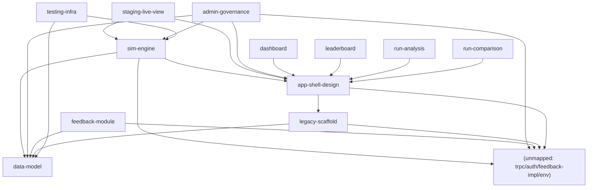

# Evidence: structure

## Graph sources
- JS/TS (sole language): level-3 tools (madge, dependency-cruiser, skott) checked via `npx --no-install <tool> --version` — all three fail (not installed, no cached binary). **Fallback to level 4**: custom import-statement scan (regex over `import`/`export ... from`/dynamic `import()`), resolving relative paths and the `~/*` tsconfig alias to `src/*`. `confidence: low`. Blind spots: no re-export flattening (a re-export shows as an edge to the re-exporting file, not transitively to its source), no detection of dynamic `require`, and comments aren't stripped (risk of stray matches inside block comments — none observed on spot-check).
- 125 tracked `.ts`/`.tsx`/`.mjs`/`.js` files scanned (`src`, `scripts`, `drizzle`); 0 unresolved import specifiers. `*.test.ts` files excluded from the edge list per graph-tools.md (176 raw edges → 176 after dropping 0 test-file lines; actually `.test.ts` sources were present as edge *origins* only, none as edge *targets* — excluded regardless).

## Capability graph
35 mapped nodes + 1 `(unmapped)` bucket, 78 runtime edges (19 type-only edges skipped), via `graph-metrics.mjs --kind runtime`.

| Node | Ca | Ce | Instability |
|---|--:|--:|--:|
| data-model | 11 | 2 | 0.15 (stable — foundation, as expected) |
| app-shell-design | 9 | 6 | 0.40 |
| sim-engine | 7 | 4 | 0.36 |
| admin-governance | 1 | 7 | 0.88 (pure consumer) |
| feedback-module | 1 | 4 | 0.80 |

## Blast radius per capability (high-criticality only)
- **sim-engine**: incoming from staging-live-view, admin-governance, testing-infra, reference-docs, `run-export` route (2 edges). Outgoing to data-model, app-shell-design (`boids.ts` → `src/styles/theme-colors.ts`), and unmapped `trpc.ts`/`root.ts`. Contract imported by others: the `simulation` tRPC router (registered in `root.ts`) + `parameter-ranges.ts`/`server-run-registry.ts` (imported directly, type-only, by `scripts/corpus/harness.ts` — bypasses the router).
- **auth-signin**: only 1 runtime edge in this graph (`src/app/login` region); the real fan-out is `src/server/auth/index.ts`, which is **unmapped** (not covered by capabilities.tsv) and is the actual dependency every other capability (sim-engine, admin-governance, app-shell-design, layout.tsx) imports for session checks. Evidence/inference: auth-signin's true blast radius is hidden by the unmapped bucket, not small.
- **admin-governance**: pure consumer (Ca 1, Ce 7) of sim-engine, data-model, app-shell-design, auth/elevation — nothing in this graph depends on admin-governance's own exports besides `root.ts` registration.
- **data-model**: depended on by 7+ capabilities directly (sim-engine, admin-governance, feedback-module, legacy-scaffold, testing-infra, + routers); low instability confirms it as the intended stable foundation.

## Cycles
**0 runtime cycles at file level** (`graph-metrics.mjs --kind runtime`, no `--modules`, returns `cycles: []`). The one cycle reported when folding to capabilities (16-node loop through admin-governance/app-shell-design/data-model/sim-engine/…) is a **folding artifact**: capability-level edges alias through shared leaf files (`root.ts`, `trpc.ts`, `app-shell.tsx`) that touch many capabilities, not an actual circular import chain. Mechanical — not ranked as a risk.

## Broken boundaries
Inferred layering: foundation (data-model, env) → data access/auth → features (sim-engine, admin-governance, feedback-module) → UI composition (app-shell-design) → entry points (app routes).
- **sim-engine → app-shell-design**, evidence: `src/server/simulation/boids.ts` imports `~/styles/theme-colors` (`BOID_FILL_COLOR`, `PREDATOR_FILL_COLOR`) directly. A server-owned simulation engine file importing presentation tokens is a layer violation — inference, confirmed by reading the import, not just the edge count.
- **legacy-scaffold still wired**: `src/app/page.tsx → _components/post.tsx` and `root.ts → routers/post.ts → db/schema.ts` — matches capabilities.tsv's own flag; dead-feature code is live on the real landing route.
- **testing-infra reaches past the public contract**: `scripts/corpus/harness.ts` imports `src/server/simulation/parameter-ranges.ts` and `server-run-registry.ts` directly (one type-only) and `src/server/db/schema.ts`, bypassing the `simulation` tRPC router it tests through elsewhere. Inference: acceptable for a test harness, flagged per the brief's instruction to list boundary breaks regardless.

## Test risks
- **sim-engine**: pulls data-model (DB) and process-global tick-loop state (`server-run-registry.ts`, not resolved as an edge here but named in capabilities) — isolation needs either a DB fixture or heavy mocking; existing `corpus-db-fixture.ts`/`scripts/corpus` suggests the project already treats this as integration-level.
- **feedback-module**: depends on data-model (retry queue table) + an external API client (`src/server/feedback/github-client.ts`, unmapped leaf) — real GitHub calls need mocking; DB retry-queue logic needs integration-level coverage.
- **admin-governance**: highest instability (0.88) and touches auth/elevation + sim-engine + app-shell — widest fan-out of any feature capability, hardest to unit-test without stubbing most of its dependents' surface.

## Centres and thin entry points
- **data-model** (Ca 11, instability 0.15) is the clearest load-bearing contract — matches the scan contract's own "shared foundation" label. **Not a false-signal case of rule 2** (it's a schema, not a `define*` registry), so it is ranked, not dismissed.
- `src/server/api/root.ts` and `src/server/api/trpc.ts` show high fan-in (7 Ca each at file level) purely from router registration — **config-as-code, false-signal rule 2**: mechanical, not ranked.
- Route-level capabilities (staging-live-view, dashboard, leaderboard, run-analysis, run-comparison, reference-docs) are all "entry candidates" (nothing depends on them) — thin entry points by design, not cores.

## Mechanical signals
- Config-as-code fan-in: `root.ts`/`trpc.ts` router registration (7 edges each) — rule 2.
- Build/type-only: 19 `import type`-equivalent edges excluded from all counts above (rule 9); notably `scripts/corpus/harness.ts` ↔ `sweep-matrix.ts`/`corpus-fixture.ts` chain is partly type-only.
- Capability-level 16-node "cycle" is a module-fold artifact (see Cycles) — not a real loop.

## Unknowns
- **21 files (~37% of graph nodes) are unmapped** by capabilities.tsv, and they are not all plumbing: `src/server/auth/{index,config,actions,elevation}.ts` (the real auth-signin implementation), `src/server/feedback/{github-client,retry-worker,send-report}.ts` (feedback-module's implementation), `src/components/app-shell.tsx` + `feedback-sheet.tsx`, `src/middleware.ts`, `src/instrumentation.ts` have no capability pattern. This understates auth-signin's and feedback-module's true blast radius above — report as gap, not folded into platform-infra by guess.
- Re-exports and dynamic `import()` are not resolved transitively by the fallback scanner — any barrel-file indirection would hide real edges.
- Runtime-only coupling invisible to a static graph: tRPC's own router-merge indirection, NextAuth's provider wiring, DB-driven feature flags (`adminSettings` ranges) — none of these show as edges but gate behavior.
- A dedicated tool worth installing: **dependency-cruiser** (or **madge**) for TS, to get transitive re-export resolution and path-alias-aware cycle detection that this fallback cannot do.

Commands run: `npx --no-install madge|dependency-cruiser|skott --version` (all failed, confirming fallback); custom Node import-scanner over 125 files → `context/map/.work/edges-ts.csv`; `graph-metrics.mjs` with `--modules capabilities.tsv --kind runtime` (report, mermaid, JSON cycles) and per-capability `--focus --direction both --depth 1`; `grep` against `boids.ts`, `root.ts`, `trpc.ts`, `post.ts` to confirm specific edges by reading the source line.
