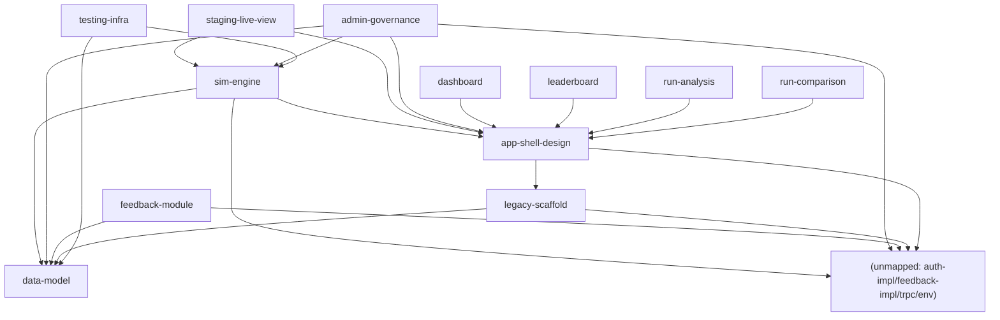

# Project Map: swarm-arena

## TL;DR

swarm-arena is a Next.js/T3 app that lets a signed-in user configure and run a 3D boids/predator-prey flocking simulation, either client-ticked ("staging") or server-owned, watch it live, score it on four-to-five factors, and compare/rank/export the results. The simulation engine (`sim-engine`) is by far the busiest and most structurally central capability — 100 commits, 275 file-changes, a genuine 9-partner hub router, and the only real cross-layer boundary break in the repo. Its primary consumer, `staging-live-view`, had a sharp one-week build-out spike that has since gone quiet. `testing-infra` is the capability actually rising right now (it carries two REJECTED/NEEDS-ATTENTION review clusters), tracking the project's own in-progress quality-strategy rollout. The repo is effectively single-person (one git identity under two names) with a 91%-agent-coauthored commit history and almost no forge-based review (2 one-off PRs, 0 issues) — "whom to ask" resolves to "read `context/changes/`/`context/archive/<id>/` and `lessons.md`", not a person.

## Terrain

| Capability | What it does | Criticality | Change | Fix pressure | Friction | Attention | Reach | Trend | Lives in |
|---|---|---|---|---|---|---|---|---|---|
| sim-engine | Flocking/predator-prey physics, scoring, server-owned tick loop, live-parameter adjustment | high (core value; other capabilities depend on it at runtime) | high (100/275) | medium (22%, real logic fixes) | medium (2 NEEDS ATTENTION reviews) | high (~9 change folders, tied for most) | high (9-partner router hub; 1 confirmed boundary break) | fading off a build-out spike (low confidence, 3-pt series) | `src/server/simulation/*`, `simulation.ts` router |
| staging-live-view | Client-staged + server-owned run configuration, live canvas/viewer | high (primary entry to sim-engine) | high (52/106) | medium (19%, UI-state bugs) | low (all reviews approved) | medium-high (~6 folders) | medium (thin entry point, but 54%-confidence co-change with sim-engine) | fading sharply (W46=51 → W47=1) | `src/app/simulation/*` |
| testing-infra | Synthetic test corpus + wall-clock perf harness, supporting the risk-first test-plan | medium (shared foundation; no single high criterion) | rising (W46=2 → W47=19) | medium (38%, iteration pattern) | high (2 REJECTED/NEEDS-ATTENTION clusters) | high (~9 folders, tied for most) | medium (feeds sim-engine, reaches past the public router) | rising, matches the live M3 test-plan rollout | `corpus-db-fixture.ts`, `scripts/corpus/*`, `scripts/perf-baseline*` |
| admin-governance | Parameter-range admin settings, temporary self-service admin elevation | high (access/permission gating) | low (6/10) | low (small base) | **high** (2 real follow-on "flake"/"confirm-resolved" changes) | medium (~4 folders) | low as a dependency (Ca 1), but highest instability (0.88) — widest fan-out, hardest to isolate in tests | front-loaded, quiet since | `src/app/admin/*`, `user.ts` elevation procedures, `adminSettings` |
| auth-signin | GitHub OAuth login, session handling | high (identity/access gating for the whole app) | low (4/4) | n/a | none observed | none beyond initial | **unknown — hidden**, see below | front-loaded, quiet since | `src/app/login`, `src/app/api/auth`; real implementation in unmapped `src/server/auth/*` |
| run-analysis | Per-run population/genetics/phase chart | medium | low-medium (11/12) | medium (27%) | none | low | thin entry point | front-loaded | `src/app/runs/[runId]`, `getRunAnalysis` |
| run-comparison | 2–4 run score/factor comparison | medium | low (7/7) | n/a | none | low | thin entry point, co-change with sim-engine (57%) | front-loaded | `src/app/runs/compare` |
| leaderboard | Ranked score list | medium | low (5/5) | n/a | none | low | thin entry point, co-change with sim-engine/run-comparison (60%) | front-loaded | `src/app/leaderboard` |
| dashboard | Post-login landing (run lists) | medium | low (5/5) | medium (40%, small base) | none | low | thin entry point | front-loaded | `src/app/dashboard` |
| run-export | JSON/CSV run export | low-medium | n/a (folded into feature work) | — | — | low | thin entry point | — | `src/app/api/runs/[runId]/export`, `run-export.ts` |
| feedback-module | In-app feedback → GitHub Issues, DB retry queue | low | **undercounted** — true footprint higher than the 1/2 reported (retry-worker/send-report/elevation unmapped) | — | — | none | medium (instability 0.80, external API + DB retry queue) | — | `feedback.ts`, `feedbackReports`; real implementation in unmapped `src/server/feedback/*` |
| reference-docs | In-app static docs | low | low (3/7) | — | — | none | thin entry point | — | `src/app/reference/*` |
| legacy-scaffold | create-t3-app's demo "post" feature | low | low (4/6) | — | — | none | confirmed **still wired** into the real landing route | — | `src/app/_components/post.tsx`, `post.ts` router |

**Infrastructure, shared foundations, docs** (not ranked as business capabilities):
- **data-model** — Drizzle schema + migrations. Ca 11 / Ce 2, instability 0.15 — the real stable foundation it's meant to be, confirmed by the structure graph, not just by convention.
- **platform-infra** — GitHub Actions deploy pipeline, Docker, Caddy. 12/16 changes, 58% fix share — mechanical (deploy/CI "make it green" iteration, not product defects).
- **app-shell-design** — shared layout, design tokens, shadcn/ui. Ca 9 / Ce 6, instability 0.40 — every route-level capability depends on it visually.
- **docs-planning** — `context/`, `.claude/`, root `AGENTS.md`/`CLAUDE.md`. 511 of 542 commits (94%) — mechanical workflow lockstep (every `/10x-*` step writes progress to `plan.md`/`roadmap.md`), excluded from the ranking above but reported for completeness.

**Coverage**: history — 93.3% of file-changes mapped to a business/foundation capability (6.7% unmapped, under the 10% fold-in threshold, mostly plumbing plus a real feedback-module gap — see Limitations). Structure graph — 63% of the 56 scanned graph nodes mapped (37% unmapped, including the *real* implementations of auth-signin and feedback-module — a gap, not noise; see Limitations).

## Real couplings

| Pair | Direction | Evidence | Mechanical? |
|---|---|---|---|
| sim-engine ↔ staging-live-view | bidirectional | runtime (shared router + canvas/live-param wiring) + co-change support=28, 54% confidence | no — hand-kept, real |
| sim-engine ↔ data-model | bidirectional | co-change support=10, 59% confidence; runtime edge confirmed in structure graph | no |
| sim-engine → app-shell-design | one-way | runtime: `src/server/simulation/boids.ts` imports `~/styles/theme-colors` directly | no — this is the one real **boundary break** (see Risk zones) |
| admin-governance → {sim-engine, data-model, app-shell-design} | one-way (pure consumer, Ca 1) | runtime graph | no |
| testing-infra → sim-engine | one-way, bypasses the public contract | `scripts/corpus/harness.ts` imports `parameter-ranges.ts`/`server-run-registry.ts` directly instead of through the `simulation` tRPC router | acceptable-for-test-harness, but a real boundary note |
| legacy-scaffold → data-model | one-way | runtime: `root.ts → routers/post.ts → db/schema.ts`, and `page.tsx → _components/post.tsx` | no — confirms dead-feature code is still live on the real landing route |
| run-comparison / leaderboard / run-analysis → sim-engine | one-way | co-change, 57–60% confidence each | no |
| docs-planning ↔ everything | — | 511/542 commits touch `context/` alongside product work | **yes** — every `/10x-*` skill step writes progress; excluded from risk ranking |
| `root.ts`/`trpc.ts` fan-in (7 edges each) | — | router-registration config-as-code | **yes** |

## Risk zones

1. **sim-engine** — criticality high, buzz high in 3 independent families (change, attention, reach). It's the busiest real capability (100 commits/275 changes), tied for the most dedicated change folders (~9), and structure evidence confirms it as a genuine 9-partner hub (`simulation.ts` router) with the repo's one real layer violation: `boids.ts` (server-owned engine) imports presentation tokens (`~/styles/theme-colors`) directly. Files: `src/server/api/routers/simulation.ts`, `src/server/simulation/{boids,server-run-registry}.ts`.
2. **testing-infra** — criticality medium (shared foundation, no single high criterion), buzz high in 3 families (change is actively rising W46→W47, matching the live test-plan rollout; friction is high — 2 of its change folders carry REJECTED/NEEDS-ATTENTION review verdicts; attention is tied for highest at ~9 folders). This is where quality work is happening *right now*, not a legacy concern. Files: `scripts/corpus/harness.ts`, `src/server/api/routers/corpus-db-fixture.ts`.
3. **staging-live-view** — criticality high, buzz high in 2 families (change — second-highest raw volume at 52/106 — and a confirmed, non-mechanical 54%-confidence co-change coupling to the sim-engine hub). Caveat: its change signal is **fading sharply** (51 commits in W46, 1 in W47) — list this as a zone that already had its hot period rather than one still heating up; worth confirming on return whether that's "feature-complete" or "between pushes."

**Watch** (named, not promoted — each misses the two-independent-family bar on raw volume but carries a real signal worth tracking):
- **admin-governance** — high criticality (permission gating), and friction is genuinely high: two follow-on change folders (`pre-existing-admin-settings-flakes`, `admin-ranges-and-hook-test-flakes`) were opened specifically to re-fix issues in this capability, plus a `confirm-admin-elevation-mechanism-resolved` closure pass. `lessons.md` itself states the underlying race is "mitigated, not eliminated." Separately, structure flags it as the highest-instability capability in the graph (0.88, Ca 1 / Ce 7) — hardest to unit-test in isolation, a design-quality risk distinct from blast radius.
- **auth-signin** (open question, not a demonstrated risk) — high criticality by definition (identity/access gating for the entire app), but its real implementation (`src/server/auth/*`) sits in capabilities.tsv's unmapped bucket, so its true blast radius is invisible to this scan rather than confirmed low. Per the verification rule for contradictions: this is a critical capability the evidence can't currently speak to — refine the capability map before trusting any "low reach" reading of auth-signin.

**Looks hot, is not** (demoted — mechanical per false-signals.md):
- `docs-planning`'s 94%-of-all-commits share — every `/10x-*` skill writes progress to `context/`; it's workflow lockstep, not code churn.
- `platform-infra`'s 58% fix share — deploy/CI "make the pipeline green" iteration (forwarded-host headers, auth-secret plumbing), not product defects.
- `drizzle/meta/_journal.json` churn — drizzle-kit regenerates this snapshot on every migration; build-guarded.
- `root.ts`/`trpc.ts` apparent 7-edge fan-in — router-registration config-as-code.
- `.env.example`/`src/env.js`/`root.ts`/`src/server/auth/config.ts` looking like structural hubs — an artifact of being unmapped in capabilities.tsv, not real architectural fan-in.
- The capability-level 16-node "cycle" — a module-folding artifact through shared leaf files (`root.ts`, `trpc.ts`, `app-shell.tsx`), not a real circular import (0 real file-level cycles confirmed).
- 2 git author identities — same person (bootstrap-era squash-merge PRs, then direct commits); not a concentration risk, it's the baseline for a 1-person repo.

## Whom to ask

There is effectively one person behind every capability: git identity `Krzysztof Tatarczyk` (with 2 early commits under a second identity, `kris1617`, almost certainly the same person's bootstrap-era squash-merge PRs). No second collaborator exists (`gh api .../collaborators` returns exactly one, `kris1617`, role admin), and no `CONTRIBUTING.md`/`CODEOWNERS` exists to extend if a team forms.

In place of a second person to triangulate with, this project already produces a design-doc trail per change: read `context/changes/<id>/` (active) or `context/archive/<date>-<id>/` (closed) for the research/plan/review history behind any capability, and `context/foundation/lessons.md` (13 entries) for recorded recurring mistakes — several (tRPC subscriptions via `createCaller`, SQLite `busy_timeout`, `ctx.db` vs. module singleton) are sim-engine/testing-infra-adjacent and worth reading before touching those areas.

## First day

1. `src/server/api/routers/simulation.ts` — the sim-engine contract; every other capability that touches simulation data goes through this router.
2. `src/server/simulation/server-run-registry.ts` — the server-owned tick loop/registry; where a run actually lives while active.
3. `src/server/simulation/boids.ts` — the core physics; note the presentation-token import flagged above before changing it.
4. `src/app/simulation/_components/simulation-canvas.tsx` — staging-live-view's largest file (31 commits); the client-ticked rendering loop.
5. `src/app/simulation/page.tsx` — staging-live-view's entry route (run configuration form, start/startServer mutations).
6. `src/server/db/schema.ts` — the data-model foundation; every feature's migration lands here first.
7. `src/server/simulation/parameter-ranges.ts` — the shared validation/ranges contract admin settings feed and every surface displaying parameters reads.
8. `context/foundation/lessons.md` + `context/foundation/roadmap.md` — this project's own memory; read before relying on "ask a teammate," because there isn't one.

## Limitations

- **Window**: whole history (13 days, 542 commits) — shorter than the skill's default 12-month window by construction, not a truncation. Trend evidence rests on only 3 weekly buckets (W45 birth, W46 build-out, W47 partial-to-date); every "rising"/"fading" call above is explicitly low-confidence, not a mature trend.
- **Evidence sources**: git is exhaustive and reliable. The forge (`gh`) is usable but near-empty — 2 merged PRs (same minute, 2026-11-11, a one-time branch-protection trial) and 0 issues. All review/friction signal instead comes from this project's own `context/changes/`→`context/archive/` convention (68 review files read by heading/verdict only, not full bodies).
- **Graph coverage**: TypeScript/TSX only language in this repo. `madge`, `dependency-cruiser` and `skott` were all checked and unavailable without installing something new (not installed, per the skill's own read-only constraint) — the structure evidence rests on a custom level-4 import-scan fallback with explicitly **low confidence**: no re-export flattening, no dynamic-`import()` resolution. Installing `dependency-cruiser` or `madge` is recommended before trusting any "0 cycles" claim at full rigor.
- **Capability coverage**: 93.3% of history-based file-changes mapped; 6.7% unmapped (mostly plumbing, but including a real feedback-module gap). The structure graph is worse: only 63% of scanned nodes are mapped — critically, the **actual implementations** of auth-signin (`src/server/auth/*`) and feedback-module (`src/server/feedback/*`) are unmapped, which is why both capabilities' "reach" readings above are marked unknown/undercounted rather than confirmed low. Refining `capabilities.tsv` to include these paths before any deeper auth- or feedback-focused investigation would sharpen this map materially.
- **What this map does not say**: it has no visibility into purely runtime-only coupling — tRPC's router-merge indirection, NextAuth's provider wiring, or the `adminSettings`-driven parameter-range feature-flag behavior that gates `sim-engine`/`staging-live-view` without showing as a static edge.
- **Unknowns worth a focused investigation**: (1) feedback-module's true activity/footprint, currently undercounted; (2) auth-signin's true blast radius, currently hidden by the capability-map gap; (3) whether the admin-ranges cross-process race that `lessons.md` calls "mitigated, not eliminated" is actually closed, or still open; (4) whether a production error tracker exists today (one archived change is literally titled `fix-production-trpc-error-logging`, implying a past gap in production error visibility that this pass couldn't confirm is now closed).
