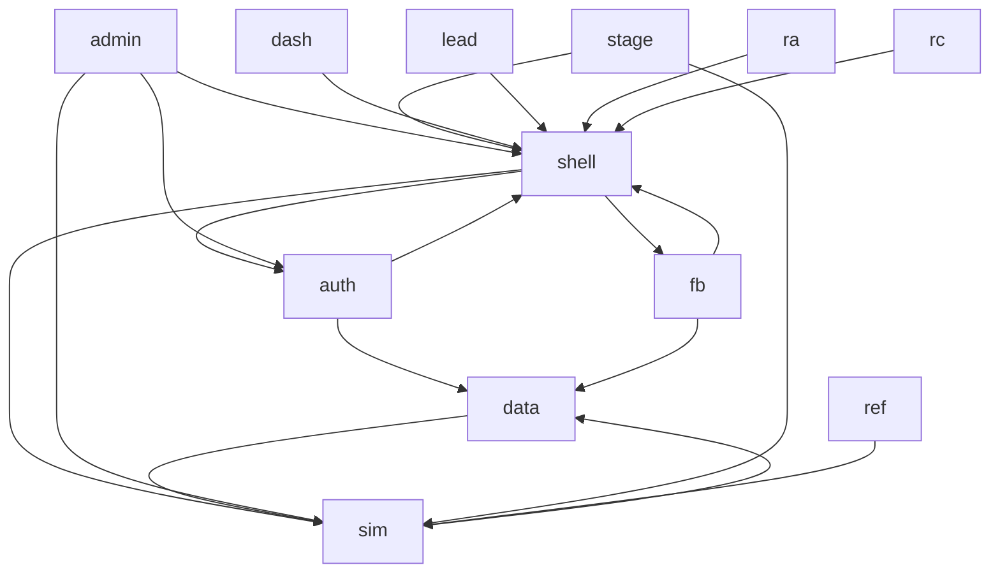

# Evidence: structure

## Graph sources
TypeScript/TSX — checked fallback chain in order: (1) no repo-native graph tooling/config found (no dependency-cruiser/madge config, no module-boundary lint rule); (2) toolchain: `typescript` is an installed dependency (`node_modules/typescript`, `tsc` present) but using the compiler API to build an import graph was out of scope for this pass's effort; (3) dedicated tools — confirmed **not installed**: `which madge dependency-cruiser depcruise skott ast-grep sg` all empty, `npm ls -g` shows none, no cached npx binaries found. Nothing was installed (read-only, per contract). (4) **Universal fallback used**: custom regex-based import/export scan (not `ast-grep`, which is absent) over all tracked `.ts`/`.tsx` under `src/`, `scripts/`, `tools/ai-reviewer/`, excluding `*.test.ts(x)`; comments stripped first (a stray apostrophe inside a `//` comment silently dropped a real edge on the first pass — fixed, see Mechanical). Relative and `~/*` (tsconfig path alias) specifiers resolved to files; bare package names and `node:*` treated as external and dropped. **Confidence: low**, matching the 2026-11-17 map's own level-4 fallback.
- 105 source files scanned, 372 raw import/export specifiers, 221 resolved to in-repo files, 1 unresolved (`tools/ai-reviewer/src/review.ts` → `./review-schema.js`, a `.js`-extension ESM specifier pointing at a `.ts` file — resolver gap, confirmed by hand that this is `review-schema.ts` in the same dir).
- Blind spots this fallback cannot see: dynamic `import()`, re-exports it didn't resolve, DI/reflection, any runtime wiring (tRPC router registration in `root.ts` is structural, not an import edge to the router's internals beyond the file itself).

## Capability graph
Runtime edges only, folded via `capabilities.tsv` (ungrouped unmapped files kept visible where relevant below).

| Node | Ca | Ce | Instability |
|---|--:|--:|--:|
| shell | 9 | 4 | 0.31 |
| sim | 6 | 2 | 0.25 |
| data | 4 | 2 | 0.33 |
| auth | 3 | 3 | 0.50 |
| fb | 2 | 4 | 0.67 |
| admin | 0 | 4 | 1.00 |
| stage | 0 | 3 | 1.00 |
| dash | 0 | 2 | 1.00 |
| lead/ra/rc/ref | 0 | 1–2 | 1.00 |

14 nodes total incl. `(unmapped)`/`unmapped`, 39 edges, 21 files unmapped (corpus scripts, API route handlers, trpc wiring) — not shown above for the ≤20-node limit.

## Blast radius per capability
- **sim** (evidence): incoming from `stage`, `admin`, `ref`, `shell` (via `theme-colors.ts`), `data` (test-reset helper), plus unmapped corpus/export-route files and `src/server/api/routers/simulation.ts` (tRPC router — itself unmapped because `capabilities.tsv` only claims `src/server/simulation/*`, not the router file under `src/server/api/routers/`). Outgoing: `data` only. Confirms last map's "9-partner hub" shape, now 6 in-repo capability partners by this count plus the router/corpus consumers.
- **shell** (`src/components/ui`, `app-shell.tsx`, `styles/*`): incoming from every feature capability (auth, fb, admin, dash, lead, ra, rc, stage) — expected shared-UI fan-in (false-signal rule 2, config-as-code-like). Outgoing to `auth`, `fb`, `sim` — the last one is the boundary break below.
- **data** (`src/server/db`, `drizzle`): incoming from sim, auth, fb, and every tRPC router (unmapped) + corpus scripts. Outgoing to `sim` (one file, see Cycles).
- **admin**: outgoing only (shell, auth, sim) — a thin consumer, Ca 0, confirms "entry/leaf-like" shape.

## Cycles
Runtime only; two real 2-node cycles, both small and explainable, not inflated:
1. **shell ⇄ auth** — `src/components/user-menu.tsx` (shell) imports `src/server/auth/actions.ts`; `src/app/login/_components/sign-in-button.tsx` (auth) imports shell's `icons/github-icon.tsx` and `ui/button.tsx`. Pattern: a feature consumes shared UI (auth→shell) while shell's own chrome needs an auth action (shell→auth) to render sign-out. Mechanical/expected, not an architecture smell.
2. **data ⇄ sim** — `sim`'s `server-run-registry.ts`/`orphan-sweep.ts` import `db/index.ts`+`schema.ts` (expected: sim persists via data); reverse edge is a single file, `src/server/db/admin-settings-test-reset.ts`, importing `sim`'s `parameter-ranges.ts` — a test-support reset helper misfolded into `data` by the capability inventory, not a real data→sim dependency. Flag for the inventory refinement pass.
3. **shell ⇄ fb** — `app-shell.tsx` mounts `feedback-sheet.tsx` (shell→fb, composition root); `feedback-sheet.tsx` uses 5 shell `ui/*` primitives (fb→shell, shared-UI consumption). Same shared-UI pattern as #1.

No larger cycle exists among capabilities once type-only edges (16, see Mechanical) are excluded — the reported "7-node" cycle from the raw tool run collapses to these three 2-node loops when inspected at file level (false-signal rule: a small real loop, not a 7-node one).

## Broken boundaries
Inferred layering: foundation (`data`, `shell` tokens) → data access (`data`) → features (`sim`, `auth`, `fb`, `admin`, `dash`, …) → entry points (route pages).
- **Confirmed still open, unchanged**: `src/styles/theme-colors.ts` (presentation layer, `shell`) re-exports `BOID_SEED_COLOR`/`PREDATOR_SEED_COLOR`/`FOOD_SEED_COLOR` from `src/server/simulation/seed-colors.ts` (`sim`, server-layer file) — confirmed via direct read of both files, not just the old map. This is the one real cross-layer edge going the wrong way (presentation depending on a server module for canvas-readable constants) that the prior map flagged. It is *documented* in both files' comments as deliberate (seed-colors.ts is sim's source of truth; theme-colors.ts re-exports for canvas rendering, which can't read CSS vars) — not an accident, but still a layering violation by the inferred rule.
- No other presentation→server edges found; `stage`→`sim` is a normal feature→engine edge (reading sim's types/functions to drive client ticking), not layer-inverted.

## Test risks
- **sim**: hardest to unit-test in isolation — pulls `data` (db) directly from `server-run-registry.ts`/`orphan-sweep.ts`; integration-style DB setup needed for those paths, pure-function tests fine for `boids.ts`/`parameter-ranges.ts`/`parameter-suggestion.ts` (no outgoing edges beyond `seed-colors`/`spatial-grid`, both in-capability).
- **fb** (instability 0.67): depends on `shell` (UI) and `data`+`unmapped` (trpc router, github client) — needs both a rendering harness and an external-API stub (GitHub) to test end-to-end; matches existing `github-client.test.ts`/`feedback.test.ts` split already in the repo.
- **admin/stage/dash/lead/ra/rc/ref**: Ca 0 everywhere — safe to test in isolation from other capabilities' internals, but each pulls `shell` so needs the design-system/provider tree mocked or rendered.

## Centres and thin entry points
- **shell**: Ca 9, instability 0.31 — confirms prior map's "load-bearing contract." High fan-in is shared-UI consumption (false-signal rule 2), not fragile coupling.
- **sim**: Ca 6, instability 0.25 — the most depended-upon, least-dependent capability in the graph; still the engine hub the 2026-11-17 map described, now with one more confirmed inbound edge (`ref`→sim via `parameter-ranges` import in the reference/parameters page) not previously itemized here.
- **admin, stage, dash, lead, ra, rc, ref**: all Ca 0 (entry candidates) — thin feature/route layers that only delegate, consistent with "entry point, not core."

## Mechanical signals
- 16 type-only (`import type`) edges excluded from the graph above (rule 9) — none of them was load-bearing to a cycle once separated.
- 0 build-kind edges (no `dist/`/`build/` imports found; confirmed via `.gitignore` — nothing committed to ignore edges around).
- Shared-UI fan-in into `shell` (9 incoming capabilities) is config-as-code-shaped (rule 2): every feature imports `components/ui/*`; a Biome/TS build break would catch drift loudly.
- `tools/ai-reviewer` is config-as-code isolated, not a false signal needing suppression: zero edges in or out of `src/` in either raw-grep or resolved-edge form; it is not an npm workspace member of the root `package.json`, confirming the module-root note in the scan contract. It only imports `node:fs`, `@anthropic-ai/claude-agent-sdk`, `zod`, and its own `./review-schema.js`.

## Unknowns
- **Compile-time-only initial pass dropped a real edge** (theme-colors→seed-colors) because a bare apostrophe inside a `//` comment broke the naive from-clause regex; fixed by stripping comments first. Residual risk: other files with similarly adversarial comment/string content could still hide an edge this scan didn't catch — treat this fallback's negative results ("no edge found") as weaker than its positive results.
- **`src/server/api/routers/simulation.ts`** (sim's own tRPC router) folds to `unmapped` under the current `capabilities.tsv`, not `sim` — the capability inventory's path list only covers `src/server/simulation/*`; the router file lives under `src/server/api/routers/` and isn't claimed. Real sim blast radius is likely one hop wider (whatever calls this router) than what's shown. Worth a capabilities.tsv fix in the next pass, not done here (out of this sub-agent's scope).
- No runtime coupling beyond static imports was checked (DI, feature flags, dynamic `import()`, tRPC's own dynamic dispatch via `root.ts`, queues, webhooks) — none found in a first pass but not exhaustively ruled out.
- Dedicated tool worth installing for a higher-confidence rerun: **dependency-cruiser** (reads `tsconfig.json` paths natively, handles re-exports and dynamic imports better than this regex fallback) or **madge** for a quick circular-dependency double-check.
- Languages without a graph: none — repo is TypeScript-only per scan contract (root + `tools/ai-reviewer`).

Commands run: `which madge dependency-cruiser depcruise skott ast-grep sg`; `npm ls -g --depth=0`; `git ls-files` (file inventory); custom Python regex extractor + resolver (ad hoc, not a named CLI tool) to build `edges-ts.csv`; `node .claude/skills/10x-repo-map/scripts/graph-metrics.mjs context/map/.work/edges-ts.csv --modules context/map/.work/capabilities.tsv --kind runtime [--unmapped group|--emit mermaid|--focus <node> --direction both --depth 1]`; targeted `grep`/`cat` on `theme-colors.ts`, `seed-colors.ts`, `tools/ai-reviewer/**`.
