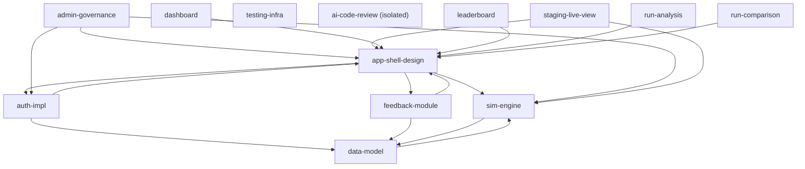

# Project Map: swarm-arena

## TL;DR

swarm-arena is a Next.js/T3 app that lets a signed-in user configure and run a 3D boids/predator-prey flocking simulation — client-ticked ("staging") or server-owned — watch it live, score it, and compare/rank/export results. Since the 2026-11-17 map, the project nearly doubled its commit count (396→800) and genuinely grew: a full per-tribe/predator-tribe configuration system, a milestone-scale UI/design-token overhaul across every user-facing page, a from-scratch test-plan quality program (unit/integration/E2E/visual-regression/perf-baseline), and a brand-new standalone module, `tools/ai-reviewer` — an AI-powered diff-review CI tool, built in one ~13-hour burst and so far fully isolated from the main app. `sim-engine` remains the busiest, most structurally central capability and the one with a confirmed, still-open cross-layer boundary break (`theme-colors.ts` reaching into server code); `testing-infra` is now the fastest-rising capability by a wide margin, tracking the project's own in-progress quality rollout. The repo is still effectively single-person (one git identity under two names, 86% of commits carrying an AI co-author trailer) with near-zero forge-based review — "whom to ask" resolves to "read `context/changes/`/`context/archive/<id>/reviews/` and `lessons.md`," not a person, same as before.

## Terrain

| Capability | What it does | Criticality | Buzz: change | Buzz: fix pressure | Buzz: friction | Buzz: attention | Buzz: reach | Trend | Lives in |
|---|---|---|---|---|---|---|---|---|---|
| **sim-engine** | Boids/predator-prey tick logic, genetics, per-tribe config, scoring | High (core value; others depend on it at runtime) | High | Medium (20%, mostly review follow-ups) | **High** (crossbreeding/per-tribe work: 14+11 second-attempt touches) | Medium (7 verdict hits on `per-tribe-behavior-weights`) | **High** (Ca=6, hub, confirmed boundary break) | Constant-high (~50 commits/wk) | `src/server/simulation/*` |
| **testing-infra** | Unit/integration/E2E/visual-regression/perf-baseline suites, quality gates | High (gates every deploy) | **High**, rising fastest of any real capability | Medium (25%) | **High** (3 scopes at 14 touches each; 2 lessons.md-confirmed recurring flakes) | Medium-high | Unknown (not graphed — tests don't carry runtime edges) | Rising sharply (1→111→122/wk) | `tests/**`, `**/*.test.ts(x)`, `.github/workflows/*` |
| **auth-impl** | NextAuth/OAuth sign-in, session, test-auth bypass | High (identity/access) | Low (21 commits, constant) | **High** (33% fix ratio — highest of any capability, though low volume) | Medium (1 real confirmed security fix: open-redirect bypass) | Medium-high (tied-highest verdict density, 7) | Medium (Ca=3/Ce=3, in one mechanical cycle) | Constant | `src/server/auth/*`, `src/app/login/*`, `src/middleware.ts` |
| app-shell-design | Shared design system: sidebar/AppShell, tokens, shadcn `ui/` | Medium-High (shared foundation) | Low-medium (24, constant) | Low (mechanical polish) | Low (UI-refresh friction is one shared initiative, not independent) | Medium (restyle review cluster) | **High** (Ca=9 — every feature depends on it) | Constant | `src/components/ui/*`, `app-shell.tsx`, `src/styles/*` |
| admin-governance | Admin parameter ranges, self-elevation, admin pages | High (identity/access-adjacent, repo-wide effect) | Low (8) | Low-medium | Medium (pre-existing, lessons.md-confirmed flakiness) | Low | Low (Ca=0, thin/leaf) | Flat | `src/app/admin/*`, schema (`adminSettings`) |
| data-model | Persisted runs/scores/history | High (data created/changed/deleted; others depend on it) | Low-medium (25, constant) | Low | Low | Low | Medium (Ca=4/Ce=2; one misfolded test-helper cycle, see Real couplings) | Constant | `src/server/db/*`, `drizzle/*` |
| feedback-module | In-app feedback → GitHub Issues | Medium (external integration, non-core) | Low (5) | Low | Low | Low-medium | Medium (Ce=4, instability 0.67) | **Coldest** — no commits since 2026-11-16 | `src/server/feedback/*`, schema (`feedbackReports`) |
| ai-code-review | Standalone AI diff-review CI tool | Medium (security-review intent, not in runtime path) | Too new (2 commits) | Unknown | Unknown | Medium (own impl-review: 5 verdict hits, highest of any) | **Isolated** — 0 edges to/from `src/` | New (built in one ~13h burst, 2026-11-17/18) | `tools/ai-reviewer/*` |
| dashboard / leaderboard / run-analysis / run-comparison / reference-docs / kitchen-sink-showcase | Feature route pages (own-runs list, rankings, run detail/compare, in-app docs, design-token showcases) | Medium / Medium / Medium / Medium / Low-Medium / Low | Low, flat across all six | Low (mechanical UI polish) | Low (same shared restyle initiative) | Low | Low (all Ca=0 — thin entry points) | Flat | `src/app/{dashboard,leaderboard,runs,reference}/*`, `*/kitchen-sink/*` |

**Non-business buckets**: platform & infrastructure (`.github/workflows`, `Dockerfile`, `Caddyfile`, `deploy.sh`, `.claude/*`) — 26 commits/200 file-changes (heavy toolkit-manifest churn), fix ratio 23% but mechanical (iteration-to-green on deploy); docs & planning (`context/foundation`, `context/changes`, `context/archive`, `context/domain`) — 723 commits/1705 changes, by far the largest raw count but **mechanical**: this project's own toolkit convention co-commits code with its change-folder prose, so one cause explains near-universal co-change with every other capability, not 18 separate relationships.

**Coverage**: unmapped file-changes 8.4% (262/3106) — under the 10% refine threshold, no refinement needed this pass. One known gap: `src/server/api/routers/simulation.ts` (sim's own tRPC router) currently folds to `unmapped` in `capabilities.tsv` rather than `sim` — a footprint-file fix for the next pass, not done here; real `sim` blast radius is likely one hop wider than shown.

## Real couplings

- **sim ↔ test, confidence 0.92 (history, evidence)** — sim code and its tests move together in the same commit almost every time; the strongest real signal in the repo. Direction-only: sim commits almost always include tests, test commits only 39% include sim changes — consistent with, but not proof of, TDD discipline.
- **shell → sim via `theme-colors.ts` → `seed-colors.ts` (structure, evidence, hand-kept)** — confirmed still open by direct file read: the presentation-layer color file re-exports boid/predator/food seed colors from a server-layer file, because canvas rendering can't read CSS custom properties. Documented as deliberate in both files' own comments — not an accident, but still a cross-layer edge pointing the wrong way by the inferred layering rule. Too low-volume for co-change evidence either way; AGENTS.md itself already flags this as a manual-sync risk nothing enforces.
- **shell ⇄ auth, shell ⇄ fb (structure, evidence, mechanical)** — two small, real 2-node cycles: shared UI consumed by a feature, which in turn needs one auth action (sign-out) or one GitHub-feedback component mounted into the shell's own chrome. Normal shared-UI composition, not an architecture smell.
- **data ⇄ sim (structure, evidence, misfolded — not a real coupling)** — the reverse edge is one file, `src/server/db/admin-settings-test-reset.ts`, a test-support helper that imports sim's `parameter-ranges.ts`. It is capability-inventory noise (should fold into `test`, not `data`), not a real data→sim dependency.
- **Router/schema/package.json hub fan-in (history, evidence, mechanical)** — `simulation.ts` router (14 partners), `schema.ts`+migration snapshot (10/8 partners), `package.json` (6) are config/schema/dependency fan-in, not fragile coupling (routers and schemas are expected to be touched by everything that uses them).
- **`tools/ai-reviewer` is fully isolated (structure, evidence)** — zero import edges to or from `src/` in either direction, not an npm workspace member; only depends on `node:fs`, `@anthropic-ai/claude-agent-sdk`, `zod`, and its own schema file. A real monorepo-boundary question was worth checking given it's new; the answer is clean.

## Risk zones

1. **sim-engine** — High criticality, three independent high-buzz signals: change (constant-high, the busiest real capability besides mechanical docs), friction (two features — crossbreeding, per-tribe config — each needed 11-14 touches including explicit fixes before landing), and reach (the graph's highest-instability hub, plus the one confirmed cross-layer boundary break). Files: `src/server/simulation/boids.ts`, `server-run-registry.ts`, `parameter-ranges.ts`, `seed-colors.ts`.
2. **testing-infra** — High criticality (gates every deploy via `deploy.yml`'s `needs: test`), two independent high-buzz signals: change (by far the fastest-rising real capability, 1→111→122 commits/week) and friction (`lessons.md` independently confirms two specific, cross-phase recurring flakes — a named off-by-one test and CI-runner timing variance in throttle-window tests — not demoted, since they're confirmed recurring in a durable project record, not just a raw commit count). Files: `tests/e2e/*.spec.ts`, `context/foundation/test-plan.md`, `context/foundation/lessons.md`.
3. **auth-impl** — High criticality (identity/access), with a caveat this report states plainly: volume is low (21 commits), so this call rests more on severity than frequency. Two signals: fix pressure (33% fix ratio, the highest of any capability, including one real, confirmed security fix — "close open-redirect bypass") and attention (verdict density tied-highest in review history). Files: `src/server/auth/config.ts`, `src/middleware.ts`, `src/app/login/*`.

**Watch** (narrowly missed the two-family bar, listed separately per the method):

- **app-shell-design** — the single highest-reach node in the graph (Ca=9, every feature capability depends on it), but its only clean high-buzz signal is reach itself; the apparent friction signal (a same-day review cluster across 6 capabilities) is one shared restyle initiative, not independent friction, and is demoted below. Worth watching precisely because a regression here is repo-wide, not because current buzz says so.
- **admin-governance** — `lessons.md` documents a specific, partially-mitigated cross-process race condition (`pre-existing-admin-settings-flakes`) that is real and still only a mitigation, not a full fix, by the lesson's own words. Only one independent buzz family clears (friction), so it stays a watch item, not a full risk zone.

**Looks hot, is not** (mechanical signals that would otherwise look like risk):

- docs & planning's near-universal 90%+ co-change with every capability — the toolkit's own convention of committing code with its change-folder prose, one cause, not 18 relationships.
- `infra`'s 23% fix ratio / 6× `fix(deploy)` commits — iteration-to-green on a deploy pipeline, the normal shape for that work.
- The 2026-11-20 same-day UI-refresh review cluster (6 capabilities, 2 verdict hits each) — one initiative (the `/10x-ui` chain run repeatedly across pages), not 6 independent friction signals.
- Router/schema/`package.json` fan-in — config-as-code, expected to be touched by everything that uses it.
- PR #1/#2's "0 human reviews" — not evidence of low scrutiny; this project's real review step writes to `context/changes/.../reviews/`, which both underlying change folders have. PR #10's "fail" verdict is `tools/ai-reviewer` (the project's own bot) demoing itself against a deliberately bad diff, not a human or product signal.

## Whom to ask

Single-person repo (false-signals rule 6: with ≤3 humans, concentration is the baseline, not a finding) — there is exactly one person, Krzysztof Tatarczyk, for every capability, so "whom to ask" reduces to "what has this person already tried": read their own `context/changes/<id>/` or `context/archive/<id>/` folder for the relevant capability (plan, research, reviews) before proposing a change — they are both sole author and the project's own institutional memory. For `tools/ai-reviewer` specifically, its entire history is 2 commits (feat + fix) — read both before touching it, the whole module's history fits in one sitting.

## First day

1. `context/foundation/roadmap.md` — current milestone state and what's planned next (the busiest single file in the repo by partner count).
2. `src/server/simulation/boids.ts` + `parameter-ranges.ts` — the simulation engine's core tick logic and its per-tribe/predator-tribe configuration surface; read before touching anything sim-adjacent.
3. `src/server/simulation/server-run-registry.ts` — server-owned run lifecycle; the other half of sim-engine, pulls in `data` directly.
4. `src/app/simulation/_components/simulation-canvas.tsx` + `src/styles/theme-colors.ts` — the client-staged live view and the one confirmed cross-layer boundary break (reads `seed-colors.ts` from the server layer).
5. `src/components/ui/*` + `src/components/app-shell.tsx` — the shared design system every feature capability depends on; a regression here is repo-wide.
6. `src/server/auth/config.ts` + `src/middleware.ts` — auth/session wiring and the route gate; low volume but highest fix-ratio and one real confirmed security fix.
7. `context/foundation/test-plan.md` + `context/foundation/lessons.md` — the quality-gate strategy (now the fastest-rising capability) and the durable, cross-phase-confirmed recurring-bug log.
8. `src/server/db/schema.ts` — the full data model (7 tables); everything server-side eventually reads or writes through here.

## Limitations

- **Window**: whole history, 2026-11-04..HEAD (16 days, 800 non-merge commits) — shorter than the default 12-month window because the repo is that young; no older history exists to miss.
- **Sources**: git + gh (now usable; the repo is public, was private at the last map). Forge signal is near-silent by this project's own design — real review lives in `context/changes/`/`context/archive/<id>/reviews/`, not GitHub PRs.
- **Graph coverage**: TypeScript/TSX only (the whole repo), confidence **low** — no dependency-graph tool (madge/dependency-cruiser/skott/ast-grep) is installed or was installed for this pass; evidence comes from a custom regex import/export scan (105 files, 372 specifiers, 221 resolved). One real edge (`theme-colors.ts`→`seed-colors.ts`) was initially missed by this fallback because a stray apostrophe inside a comment broke the naive regex — fixed by stripping comments first, but **treat this fallback's negative results ("no edge found") as weaker than its positive results**; other adversarial comment/string content could still hide an edge undetected. A dependency-cruiser or madge rerun would raise confidence.
- **Capability coverage**: 8.4% unmapped (under the 10% refine threshold). One specific, known gap: `src/server/api/routers/simulation.ts` folds to `unmapped`, not `sim` — a `capabilities.tsv` footprint fix for next time, not done in this pass.
- **What this map does NOT say**: it does not read source files for logic/correctness, does not run tests, does not assess code quality beyond structural/history signals, and does not check runtime coupling beyond static imports (dynamic `import()`, DI, tRPC's own dynamic dispatch via `root.ts`, queues, webhooks were not checked — none found in a first pass, not exhaustively ruled out).
- **Unknowns worth a focused investigation**: whether `theme-colors.ts`/`globals.css` actually drift in practice (too low-volume for co-change evidence either way); no production error-tracker evidence found in this scan (out of scope, not investigated); whether bugs are tracked at all outside `lessons.md`/change folders, or simply not yet needed at 16 days old (`gh issue list` returned 0); verdict-marker density (REJECTED/NEEDS ATTENTION/CRITICAL counts) is a proxy for review attention, not a read of actual severity text — review-file bodies were not opened, only grepped; no formal ownership doc exists, so team-size and "who's still on the project" are inferred from git authorship alone; per-capability agent-co-authorship percentage was not computed (only the repo-wide 86% baseline); `ai-code-review` (`tools/ai-reviewer`) is too new (2 commits) to trend or assess fix pressure — revisit once it has more history.
- **Failed/partial agents**: none — all four evidence sub-agents completed in full; coverage for all four evidence questions is complete for every high/medium-criticality capability.
